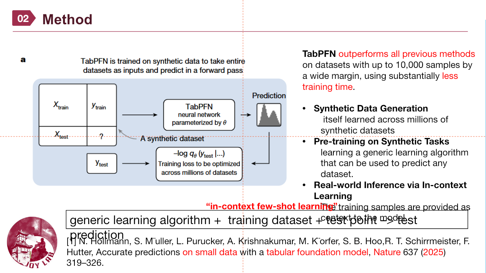
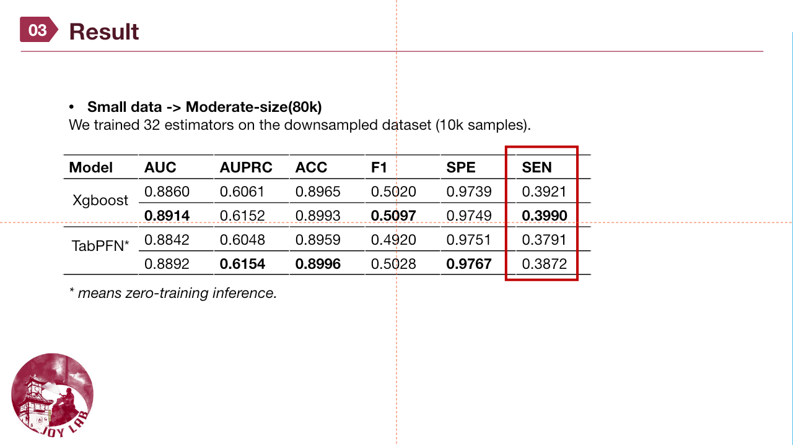

# How can we fine-tune TabPFN-2 on 80,000 rows?

**Our approach: epoch-wise resampling.** Instead of using all 80,000 rows as a single context, we reshuffle the training set each epoch into groups of at most 10,000 rows and fine-tune the same TabPFN-2 model across those groups. This lets its weights learn from all **80,000 distinct training rows**, while keeping each fine-tuning dataset within the smaller context range.

This repository demonstrates the method on the public **Covertype** dataset. It includes the resampling implementation, fine-tuning script and tests. Datasets and model weights are not bundled; Covertype fine-tuning performance is not claimed without running the full training workflow.

中文概述：本项目从 Covertype 抽取 **80,000 条训练数据**及 **20,000 条独立测试数据**。每轮重新打乱训练集，拆成最多 10,000 条的小数据集，逐批微调同一 TabPFN-2 模型。测试集从不参与重采样或参数更新。

## Questionnaire study: method and results

Slides 2–3 from **1104量表_pst** introduce TabPFN and show the questionnaire experiment using **32 estimators and a 10,000-sample downsampled dataset**. The slides mark TabPFN* as **zero-training inference**; the fine-tuning code in this repository uses the public Covertype dataset.

### Method — slide 2



### Results — slide 3



## Why resampling?

[Prior Labs describes TabPFN-2](https://priorlabs.ai/tabpfn-2) as best suited to datasets of up to **10,000 rows and 500 features**. Passing all 80,000 rows as one TabPFN-2 context exceeds that recommended range. Setting `ignore_pretraining_limits=True` alone only bypasses a guard; it does not make a single 80,000-row context equivalent to a supported one.

Our approach keeps **each fine-tuning dataset at or below 10,000 rows**:

1. Select 100,000 Covertype rows with a fixed seed, then make a stratified 80,000/20,000 train/test split.
2. At each epoch, permute **all** 80,000 training indices without replacement and split them into eight 10,000-row groups.
3. Within each group, TabPFN's fine-tuning preprocessing uses 70% as context and 30% as query targets for a gradient step. The default effective context is 7,000 rows.
4. Repeat the permutation next epoch. Every training row is used once per epoch, but its group companions change. This is the **resampling** step; it is *not* bootstrapping with duplicate rows within an epoch.
5. For evaluation, fit a clone of the tuned weights on the 80,000 training rows with `SUBSAMPLE_SAMPLES=10000`, then score the untouched 20,000-row test set. This is a separate inference-time subsampling step.

The method lets the **weights learn from 80,000 distinct rows over an epoch**. It does **not** give TabPFN-2 an 80,000-row context in a single forward pass. The 10,000-row figure is a recommended model range, not a proof that this method always improves accuracy.

## Installation

Use Python 3.10+ and a CUDA-capable GPU. Install a PyTorch build suitable for your system using the [official PyTorch selector](https://pytorch.org/get-started/locally/), then:

```bash
python -m venv .venv
# Activate .venv for your operating system.
python -m pip install -r requirements.txt
```

The example pins **`tabpfn==2.1.3`** because it uses that release's `get_preprocessed_datasets`, `fit_from_preprocessed`, and `clone_model_for_evaluation` API. Current TabPFN releases have a different fine-tuning API and may default to TabPFN-3. In this pinned release, the model loader selects **v2**. The first run can download the TabPFN-2 checkpoint; its terms remain those of [Prior Labs](https://github.com/PriorLabs/TabPFN/blob/main/LICENSE).

## Run

```bash
python finetune_80k.py --data-home ./data --output-dir ./outputs/cover80k
```

The first run downloads the public Covertype dataset through scikit-learn. For an offline run, prepare that cache first and add `--no-download`. To use a local **TabPFN-2 classifier** checkpoint, pass `--model-path /path/to/tabpfn-v2-classifier.ckpt`.

Key options:

| Option | Default | Meaning |
| --- | ---: | --- |
| `--train-rows` | 80000 | Distinct rows used for gradient training |
| `--test-rows` | 20000 | Held-out rows, never used for training |
| `--context-rows` | 10000 | Maximum rows in one resampled group and inference context |
| `--query-fraction` | 0.3 | Query/target fraction within each fine-tuning group |
| `--epochs` | 10 | Number of full passes over the 80,000 training rows |
| `--learning-rate` | 1e-5 | Adam learning rate |
| `--seed` | 42 | Dataset selection, split, and epoch permutations |

`outputs/cover80k/` contains `config.json`, per-epoch `metrics.csv`, and `tabpfn_v2_80k_finetuned.ckpt` (the fine-tuned foundation weights). To reuse those weights, construct `TabPFNClassifier(model_path="outputs/cover80k/tabpfn_v2_80k_finetuned.ckpt", inference_config={"SUBSAMPLE_SAMPLES": 10000}, ignore_pretraining_limits=True, device="cuda")`, then call `.fit(X_train, y_train)` and `.predict_proba(X_new)`. The checkpoint alone does not contain the 80,000-row training context. Outputs and model weights are excluded by `.gitignore`.

To check the resampling logic without a GPU or model download:

```bash
python -m unittest discover -s tests -v
```

## Reproducibility and scope

- This is a **multi-class classification** example on Covertype. Replace `load_cover_split()` to use your own numeric tabular dataset, preserving a separate held-out test set.
- The default full-test evaluation after each epoch can be slow and memory intensive. A CUDA GPU is required by this script.
- The initial local script that motivated this repository sampled 100,000 rows and used a 70/30 split, yielding **70,000 training rows**. This repository explicitly changes the split to **80,000 training + 20,000 test** and adds epoch-wise resampling. It is a documented adaptation, not a claim that the original script already trained on 80,000 rows.
- Source checkpoints and datasets are not redistributed. Check upstream model terms before use.

## Future work — updated 2026-11-06

[TabPFN-3 is now public in the official Prior Labs repository](https://github.com/PriorLabs/TabPFN). Its README reports supported row/feature combinations including **100,000 × 2,000**, which covers an 80,000-row dataset of Covertype's size. A future comparison should run the official TabPFN-3 baseline on the same 80,000/20,000 split, then compare predictive metrics, memory, and runtime against this TabPFN-2 resampling method. TabPFN-3's ability to accept the dataset size does not by itself establish that it will be faster or more accurate for this task.

Official public code: **[PriorLabs/TabPFN](https://github.com/PriorLabs/TabPFN)**. Check its [model licenses](https://github.com/PriorLabs/TabPFN#license) separately from this repository's code license.
